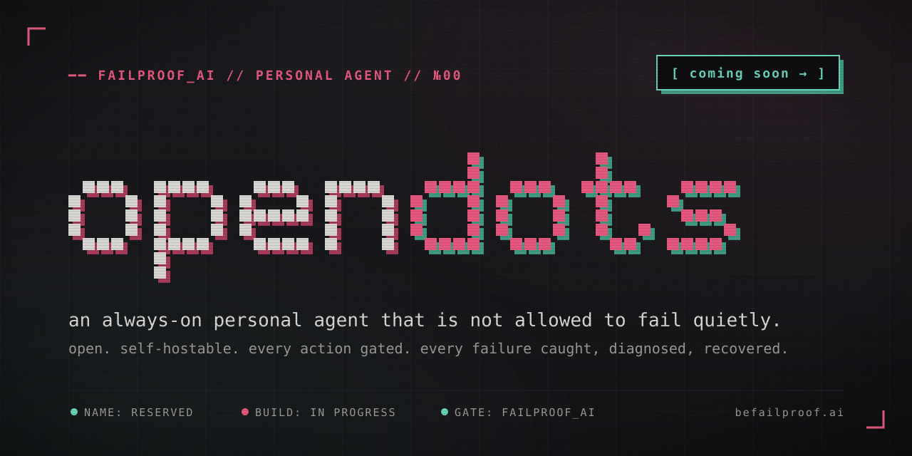

<div align="center">



**an open, always-on personal agent that is not allowed to fail quietly.**
from the team behind [failproof_ai](https://github.com/FailproofAI/failproofai).

`STATUS: PRE-ALPHA` · `NAME: RESERVED` · `BUILD: IN PROGRESS` · `CODE: COMING SOON`

[ [docs](https://docs.befailproof.ai/) ] · [ [failproofai](https://github.com/FailproofAI/failproofai) ] · [ [discord](https://discord.befailproof.ai/) ] · [ [watch this repo →](https://github.com/FailproofAI/opendots/subscription) ]

</div>

---

> [!NOTE]
> there is no code here yet. this repo holds the name, the philosophy and the plan.
> the first runnable dot ships here. **watch** the repo to get it the day it lands.

---

## ━━ the premise

personal agents are here. they have their own computer, their own browser,
your inbox, your calendar, your cards. they run while you sleep.

they will fail. not maybe — **will**.

- a retry loop books the same flight three times.
- a webpage tells your agent to forward your inbox. it does.
- a long task dies at step 41 of 60 and reports "done".
- a token expires overnight and eight hours of work are silently discarded.
- the model provider has an outage and your agent simply stops existing.

a chatbot that fails gives you a bad answer. an agent that fails **acts** —
it spends, sends, deletes, and signs as you.
the question is not whether your agent is smart. it is what happens on the
bad day.

**opendots is a personal agent built from the failure mode up.**
every action is gated by policy you own. every failure is caught, diagnosed
and recovered. every run leaves a record you can read.
and all of it is open — so you never have to take the agent's word for it.

---

## ━━ what a dot is

a **dot** is one long-running personal agent. it is yours.

```
 ┌──────────────────────────────────────────────────────────────────────┐
 │  dot  №01 "ops"                                        ● RUNNING      │
 ├──────────────────────────────────────────────────────────────────────┤
 │  computer    isolated sandbox. its own disk, shell, browser.          │
 │  identity    its own inbox + handle. never impersonates you silently. │
 │  memory      durable, inspectable, exportable. plain files.           │
 │  reach       chat · slack · email · sms · cli                         │
 │  tools       connectors + mcp servers you approve, scoped per dot     │
 │  gate        failproof_ai policies on every tool call                 │
 │  record      every step traced, replayable, auditable                 │
 └──────────────────────────────────────────────────────────────────────┘
```

one dot handles your inbox. another watches a deploy. another chases an
invoice. dots can hand work to each other — each one still behind its own
gate, with its own scopes, its own budget and its own record.

---

## ━━ philosophy

### №01 — the gate lives outside the agent

the thing that says **no** must never run inside the thing it is saying no to.
policies run in a separate process with their own credentials. a hijacked
model cannot edit them, disable them, or talk its way past them.
prompts are suggestions. hooks are law.

### №02 — fail loud. recover automatically.

no silent partial success. every task ends in exactly one of three states:
`done` · `recovered` · `stopped, here is why`.
the loop is always the same — **catch → diagnose → recover** — and when
recovery is not safe, the dot stops and tells you exactly where and why.

### №03 — approvals are policy, not vibes

when your agent may act alone and when it must ask is a written rule, not
the model's mood. rules come in two tiers:

| tier            | how it decides                                     | cost      |
|-----------------|----------------------------------------------------|-----------|
| **regex**       | deterministic patterns on the exact tool call      | 0 ms      |
| **jev**         | semantic check: does this action match your intent | 1 call    |

cheap and certain first. judgement only where patterns cannot reach.
you read every rule. you can change every rule.

### №04 — least privilege, by default, forever

secrets never enter the model's context. a dot gets surrogate handles, not
your passwords. scopes are per dot, per connector, per verb — `read` is not
`send`, `send` is not `send-as-you`. spending money needs a rule that says
it may, with a limit that says how much.

### №05 — durable by construction

long tasks are checkpointed. side effects are idempotent — a retry never
buys twice. a crash, a reboot or an expired lease resumes from the last
safe step instead of starting over or quietly giving up.

### №06 — degrade, don't die

model down? fall back to the next one you allowed. connector down? queue
and retry with a budget. gate unreachable? each action class declares
whether it fails **open** (read your calendar) or **closed** (wire money).
you decide which is which — once, in writing.

### №07 — the record is the product

every prompt, tool call, verdict, approval and recovery is traced. you can
replay a run step by step and see what the dot saw, what it decided, and
which rule allowed it. if you cannot audit it, you cannot trust it.

### №08 — open, or it doesn't count

you cannot trust a personal agent you cannot read. opendots is open source,
self-hostable, and model-agnostic. bring your own keys, your own models,
your own machine. the cloud is optional. the gate is never.

---

## ━━ how the pieces fit

```
   you
    │  chat · slack · email · sms · cli
    ▼
 ┌─────────────────────┐        ┌──────────────────────────────────┐
 │     dot runtime     │        │          failproof_ai gate        │
 │  sandbox · browser  │ ─────▶ │  №1 regex policies    (0 ms)      │
 │  memory · planner   │  every │  №2 jev semantic check (intent)   │
 │                     │  tool  │  №3 ask you            (if rule)  │
 └─────────┬───────────┘  call  └───────────────┬──────────────────┘
           │                                    │ allow / deny / ask
           ▼                                    ▼
 ┌─────────────────────┐        ┌──────────────────────────────────┐
 │   tools + world     │        │             the record            │
 │ connectors · mcp ·  │ ─────▶ │ traces · verdicts · approvals ·   │
 │ web · shell · $$$   │        │ evaluations · replay              │
 └─────────────────────┘        └───────────────┬──────────────────┘
                                                │
                                                ▼
                                   catch → diagnose → recover
```

---

## ━━ failure modes it is built against

| №  | failure mode                  | what it looks like                                  | the counter                                              |
|----|-------------------------------|-----------------------------------------------------|----------------------------------------------------------|
| 01 | **retry storm**               | the same payment fires 3× after a timeout           | idempotency keys on every side effect + retry budgets    |
| 02 | **prompt injection**          | an email or webpage instructs the agent             | untrusted-input labelling + gate outside the agent       |
| 03 | **scope creep**               | "tidy my inbox" becomes "unsubscribe from payroll"  | jev intent check against the task you actually gave      |
| 04 | **silent partial completion** | step 41 of 60 fails, the dot reports "done"         | explicit terminal states, checkpoint diff on exit        |
| 05 | **runaway spend**             | a loop burns tokens or money overnight              | per-dot budgets, hard caps, stop-and-ask on breach       |
| 06 | **credential leak**           | a secret lands in a prompt, a log, or a reply       | surrogate tokens, secrets never in model context         |
| 07 | **context bleed**             | work from one dot or one person leaks into another  | per-dot memory and scopes, no shared ambient context     |
| 08 | **tool-call drift**           | the agent calls a tool with plausible, wrong args   | schema + policy checks before execution                  |
| 09 | **crash mid-task**            | a lease expires, the work is dropped                | durable checkpoints, resume from last safe step          |
| 10 | **provider outage**           | the model api is down, the agent stops existing     | declared fallbacks, queued work, loud status             |
| 11 | **impersonation**             | the agent speaks as you without saying so           | dot identity by default, "as you" is an explicit scope   |
| 12 | **unauditable action**        | something happened and nobody can say why           | full trace + the exact rule that allowed it              |

---

## ━━ what already exists

opendots is not starting from zero. the reliability layer is already
shipping — in production, today.

| piece                                                                 | what it does                                                                                             |
|-----------------------------------------------------------------------|----------------------------------------------------------------------------------------------------------|
| [**failproofai**](https://github.com/FailproofAI/failproofai)          | observability + enforcement across 12 agent harnesses. 39 built-in policies. zero latency. runs locally. |
| [**policies**](https://github.com/FailproofAI/policies)               | open policy packs — install one command, enforced on every harness.                                      |
| [**jev-policies**](https://github.com/FailproofAI/jev-policies)       | the two-tier pack: 38 deterministic policies as a hard floor, plus jev's 16 semantic checks.             |
| [**hook-contracts**](https://github.com/FailproofAI/hook-contracts)   | what each agent cli's hooks actually send, tracked release by release.                                   |
| **failproofai cloud**                                                 | traces, evaluations and team-wide policy for every agent you run.                                         |

opendots is the agent those pieces were built to protect — assembled into
one thing you can run.

---

## ━━ roadmap

```
 №00  name + philosophy                         ● done       ← you are here
 №01  dot runtime: sandbox, browser, memory      ○ building
 №02  failproof_ai gate on every tool call        ○ building
 №03  channels: chat, slack, email, sms, cli      ○ next
 №04  durable tasks: checkpoints, resume, budgets ○ next
 №05  catch → diagnose → recover loop             ○ next
 №06  many dots: hand-offs, per-dot scopes        ○ later
 №07  self-host bundle + failproofai cloud        ○ later
```

no dates. it ships when it survives its own failure suite.

---

## ━━ what a dot will never do

- hold your raw passwords in its model context.
- spend money without a rule that allows it and a limit that caps it.
- speak as you without an explicit "as you" scope.
- disable, edit, or route around its own gate.
- report `done` on a task it did not finish.
- act without leaving a record you can read.

---

## ━━ get it first

- **watch** this repo — releases land here first.
- **star** it if you want a personal agent you can actually audit.
- join the [discord](https://discord.befailproof.ai/) — design discussions happen there.
- running agents in production today? use [failproofai](https://github.com/FailproofAI/failproofai) now — it is the gate opendots will ship with.
- questions: [support@befailproof.ai](mailto:support@befailproof.ai)

---

<div align="center">

`━━ opendots · by failproof_ai · an exosphere project ━━`

your agent will fail. make it fail safe.

</div>
